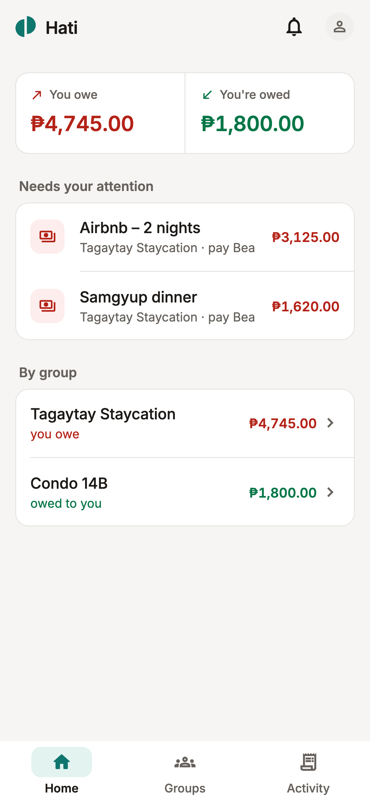
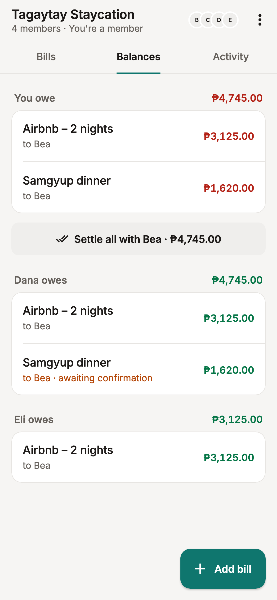
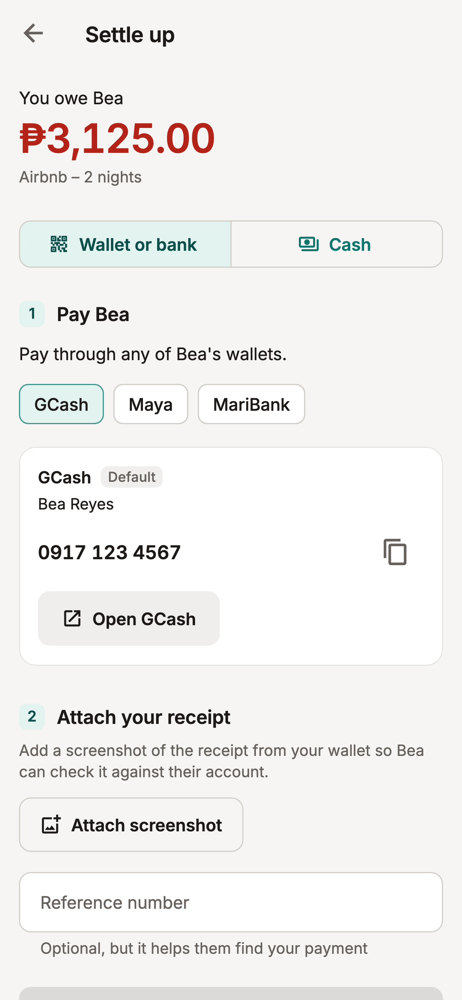

# Hati

**Split the bill. Keep the barkada.**

Hati is a bill-splitting app for groups of friends in the Philippines. It works out who owes what, shows them your GCash or Maya QR, and keeps track until everyone is square. Hati never holds or moves money: you pay each other the way you already do, and Hati keeps the record.

<p>
  
  
  
  
</p>

## Download

Get the latest Android build from **[Releases](../../releases)**.

1. Download `hati-…-arm64-v8a.apk` on your phone.
2. Open it, and allow your browser or file manager to install unknown apps when Android asks.

The APK is for 64-bit Android phones, which covers nearly every phone from the last several years. There is no iPhone build yet.

## What it does

- **Groups and bills** — split equally, by exact amounts, by percentage, by shares, or item by item with service charge and tax.
- **Settle up with a QR** — each person adds their GCash, Maya, GoTyme, ShopeePay, GrabPay, Coins.ph, PalawanPay, MariBank or bank details with a QR code. When you owe someone, Hati shows their QR, opens their wallet app, and can save the QR to your gallery.
- **Proof of payment** — "I've paid" needs a screenshot of the receipt, so the person you paid can check it. Paid in cash? Choose Cash; no screenshot needed.
- **Confirmation** — nothing counts as settled until the person who paid the bill confirms they received the money.
- **Settle all** — owe the same person on several bills? Pay once, with one screenshot.
- **Choose where you get paid** — set a default wallet, or a specific one per bill.
- **Reminders and notifications** — push notifications for new bills, payments to confirm, and nudges.
- **Invite links**, repeating bills, comments, activity history, and light and dark mode.
- **Your data** — sign in with email or Google, and delete your account from the app at any time.

## Legal

- [Terms and Conditions](https://hati-a1a23.web.app/terms)
- [Privacy Notice](https://hati-a1a23.web.app/privacy)

Hati is a record-keeping tool only. It is not a bank or payment service, and it is not responsible for failed transfers or unpaid debts between users.

## Built with

- [Flutter](https://flutter.dev) — the Android and iOS app
- [Supabase](https://supabase.com) — Postgres with row-level security, authentication, storage and edge functions
- [Firebase](https://firebase.google.com) — Cloud Messaging for push, and Hosting for invite links and the legal pages

## Developing

You need Flutter, the [Supabase CLI](https://supabase.com/docs/guides/cli), and for the website the [Firebase CLI](https://firebase.google.com/docs/cli).

```sh
# 1. Configuration (not in the repository)
cp .env.example .env                  # then fill in SUPABASE_URL and SUPABASE_PUBLISHABLE_KEY
# put google-services.json from the Firebase console in android/app/

# 2. Generated code
flutter pub get
dart run build_runner build --delete-conflicting-outputs

# 3. Run
flutter run --dart-define-from-file=.env
```

| Task | Command |
|---|---|
| App tests | `flutter test` |
| Database tests (local Postgres) | `PGBIN=/path/to/postgres/bin tool/run_sql_tests_local.sh` |
| Apply database migrations | `supabase db push` |
| Deploy an edge function | `supabase functions deploy <name>` |
| Regenerate the web legal pages | `dart run tool/gen_legal_html.dart` |
| Deploy the website | `firebase deploy --only hosting` |
| Release APK (arm64) | `flutter build apk --release --target-platform android-arm64 --dart-define-from-file=.env` |

Push notifications need secrets on the Supabase project; see [`supabase/functions/send-push/README.md`](supabase/functions/send-push/README.md).

Why things are the way they are is written down in [`DECISIONS.md`](DECISIONS.md).

## Contact

yakokakiiiii@gmail.com
